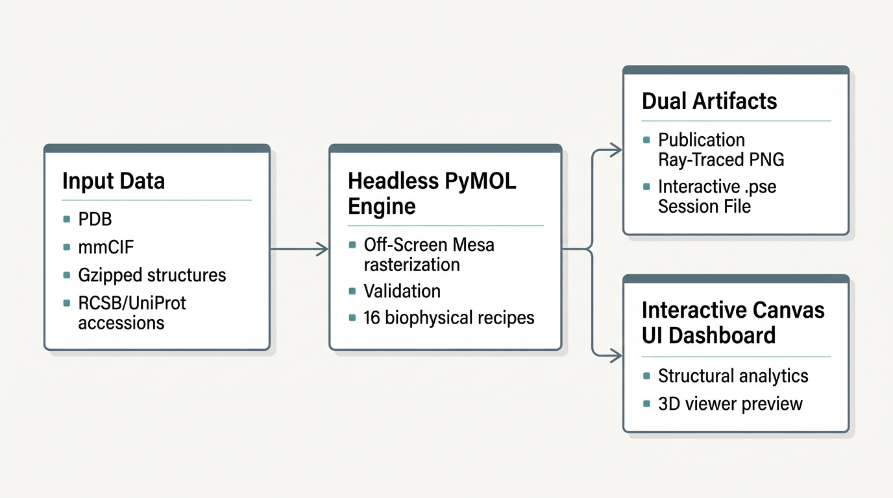

# pymol-visualize: PyMOL Molecular Visualization Skill

An automated Agent Skill (`pymol-visualize`) for headless macromolecular visualization, structural biophysics analysis, and publication-quality rendering. Conforms to standard agent skill specifications for 3D coordinate processing and rendering.

---

## 1. Overview



The `pymol-visualize` skill enables automated agents and command-line workflows to inspect, analyze, and render 3D macromolecular structures without requiring a graphical display. It generates and executes headless Python scripts powered by Off-Screen Mesa (OSMesa) software rasterization and the open-source PyMOL runtime.

### Key Capabilities
- **Secondary Structure Cartoons**: Stylized rendering of alpha helices, beta sheets, and loops with high-contrast palette mappings.
- **B-Factor and pLDDT Analysis**: Continuous spectrum mapping and standardized four-tier categorical AlphaFold confidence styling.
- **Active Site and Residue Highlighting**: Structural scaffolds with stick-level detail and CPK heteroatom coloring for catalytic residues.
- **Surface Rendering and Electrostatics**: Semi-transparent solvent-accessible surface overlays and qualitative vacuum electrostatic potential contours.
- **Oligomeric Assembly Palette**: Automatic polypeptide chain discovery and stoichiometric quantification.
- **Binding Pocket and Interaction Analysis**: Radius-based pocket isolation, solvent sphere detection, and polar contact (hydrogen bond) measurement.
- **Distance and Geometric Measurements**: Euclidean interatomic measurements between defined residue positions.
- **Structural Superposition**: Sequence-based alignment with automated fallback to Combinatorial Extension (CEAlign) for topologically divergent homologs.
- **In Silico Mutagenesis**: Rotamer selection and substitution via the PyMOL mutagenesis engine.
- **Dual Artifact Export**: Generation of both publication-resolution PNG raster images and interactive `.pse` PyMOL session files.
- **Interactive Web Dashboard**: Standalone HTML/WebGL visualization interface (`ui/dashboard.html`) for 3D model inspection, metrics tracking, and scene exploration.

### Scope and Limitations
This skill operates on three-dimensional atomic coordinates (`.pdb`, `.cif`, `.mmcif`, `.pdb.gz`, `.cif.gz`). It does not perform molecular docking simulations, molecular dynamics trajectory integration, or sequence-only operations lacking 3D coordinates.

---

## 2. Non-Technical User Guide

This section explains how to use the molecular visualization skill in plain language, without requiring software engineering or programming background.

### What is Molecular Visualization?
Proteins and other biological macromolecules are complex three-dimensional microscopic structures composed of thousands of atoms. Understanding their 3D shape helps researchers investigate how diseases function, design new medications, and evaluate biotechnology enzymes. 

This skill translates complex atomic coordinate files (like PDB or mmCIF files) into clear visual representations and interactive 3D models.

### How to Ask for Visualizations
When interacting with an assistant equipped with this skill, you can use natural, conversational language to request structural analyses. The assistant automatically identifies the appropriate scientific recipe, validates the data, generates the rendering, and delivers visual files.

### Real-World Usage Examples

#### Example 1: Visualizing an AI-Predicted Protein Structure
- **Question**: "I have an AlphaFold prediction file for human hemoglobin (`assets/synthetic_monomer.pdb`). Can you show me how confident the model is?"
- **What Happens**: The skill colors the protein using the standard 4-color confidence scale:
  - Dark Blue: Very high confidence (very reliable backbone and side chains)
  - Light Blue: High confidence (reliable backbone)
  - Yellow: Low confidence (proceed with caution)
  - Orange: Very low confidence (likely disordered or flexible regions)
- **What You Receive**:
  - A high-resolution color-coded picture.
  - A summary breakdown (e.g., 65% very high confidence, 25% confident, 10% low confidence).
  - A 3D session file that you can open and rotate on your computer.

#### Example 2: Inspecting an Active Site or Drug Binding Pocket
- **Question**: "Can you highlight the drug binding pocket in `assets/synthetic_ligand_pocket.pdb` around the molecule LIG and measure the distance between the main active residues?"
- **What Happens**: The skill isolates the binding cavity, shows the drug molecule in green sticks, highlights surrounding amino acids within 5 Angstroms in cyan sticks, and measures interatomic distances with dashed lines.
- **What You Receive**:
  - A zoomed-in image focused on the drug binding pocket with highlighted chemical contacts.
  - The precise distance measurement (e.g., `12.450 Angstroms`).
  - An interactive 3D model.

#### Example 3: Comparing Two Related Protein Shapes (Superposition)
- **Question**: "How similar is the mutant enzyme in `assets/synthetic_homolog.pdb` compared to the normal enzyme in `assets/synthetic_monomer.pdb`?"
- **What Happens**: The skill superimposes both 3D shapes on top of each other, displaying the normal protein in blue and the variant in coral. It calculates the Root-Mean-Square Deviation (RMSD), which measures how closely the two structures match.
- **What You Receive**:
  - A superimposed image showing structural overlaps and conformational differences.
  - An alignment score (e.g., RMSD = 0.285 Angstroms; lower values indicate greater similarity).

#### Example 4: Differentiating Subunits in a Protein Complex
- **Question**: "Color each separate chain in the protein complex `assets/synthetic_complex.cif` with a distinct color."
- **What Happens**: The skill automatically detects all individual protein chains in the file and assigns each a distinct color (such as teal and salmon).
- **What You Receive**:
  - An image distinguishing each subunit clearly.
  - A table listing the number of amino acids in each chain.

### How to Use the Output Files
1. **PNG Image Files (`outputs/*.png`)**: Ready to view immediately in documents, presentations, or chat interfaces.
2. **PyMOL Session Files (`outputs/*.pse`)**: Complete 3D session files that can be opened in the free desktop PyMOL application to freely rotate, zoom, cut cross-sections, and create custom views.
3. **Interactive Web Dashboard (`ui/dashboard.html`)**: Open this file in any modern web browser to rotate the 3D molecule, switch between coloring schemes (AlphaFold confidence, secondary structure, chain palettes), inspect residue statistics, and download outputs.

---

## 3. Prerequisites

### System Dependencies
- Linux (x86_64) or macOS.
- Mesa software rasterizer libraries (`libOSMesa.so` / `libGL.so`).
- `uv` package manager (version 0.10.0 or higher) available on `PATH`.

### Python Version Support
- Python >= 3.10 and < 3.13.

### Dependency Management
Dependencies are managed via `uv` using PEP 723 inline script metadata. The core packages are:
- `pymol-open-source-whl>=3.0.0`
- `pytest>=8.0.0` (for test suite execution)

---

## 4. Local Execution

### 4.1 Installation and Environment Setup
```bash
# Create a dedicated virtual environment with Python 3.12
uv venv --python 3.12 .venv

# Activate the virtual environment
source .venv/bin/activate

# Install dependencies
uv pip install -r requirements.txt
```

### 4.2 Pre-Flight Structure Validation
Run `scripts/validate_structure.py` to inspect any coordinate file prior to running rendering workflows:
```bash
# Formatted summary output
python3 scripts/validate_structure.py assets/synthetic_monomer.pdb

# Machine-readable JSON output
python3 scripts/validate_structure.py assets/synthetic_complex.cif --json
```

### 4.3 Executing Visualization Recipes via CLI
Use `scripts/pymol_runner.py` to execute any supported recipe or synthesize a standalone PEP 723 script:
```bash
# Execute AlphaFold pLDDT visualization
python3 scripts/pymol_runner.py \
  --recipe alphafold_plddt \
  --structure assets/synthetic_monomer.pdb \
  --out-png outputs/plddt_render.png \
  --out-pse outputs/plddt_session.pse

# Generate a self-contained PEP 723 script for independent execution
python3 scripts/pymol_runner.py \
  --recipe secondary_structure \
  --structure assets/synthetic_monomer.pdb \
  --out-png outputs/secstruct_render.png \
  --out-pse outputs/secstruct_session.pse \
  --generate-script run_secstruct.py

# Execute the generated standalone script with uv
uv run run_secstruct.py
```

### 4.4 Generating the Interactive Evaluation Dashboard
Generate the web dashboard to inspect 3D models and summary metrics:
```bash
python3 scripts/generate_dashboard.py \
  --structure assets/synthetic_monomer.pdb \
  --png outputs/render_monomer_web.png \
  --pse outputs/session_monomer.pse \
  --recipe secondary_structure \
  --output ui/dashboard.html
```

### 4.5 Executing the Test Suite
The test suite runs on synthetic coordinate data without external network calls:
```bash
# Run tests directly using the shell runner
./scripts/run_tests.sh

# Alternatively, run via pytest directly with uv
uv run --python 3.12 --with pytest --with pymol-open-source-whl pytest -v
```

---

## 5. Agent Skill Usage and Data Ingestion

This section describes how the skill processes user inputs and operates within agent frameworks.

### Step 1: Structure Ingestion
The `pymol-visualize` skill supports multiple input forms:

| Input Modality | Example Input | Handling Procedure |
| :--- | :--- | :--- |
| **Local File Path** | `structures/kinase.pdb` or `data/complex.cif.gz` | Resolves relative/expanded path, verifies file presence, and decompresses `.gz` transparently via `scripts/validate_structure.py`. |
| **PDB Accession ID** | `1UBQ` or `4HHB` | Downloads the coordinate file via `python3 scripts/fetch_structure.py --pdb 1UBQ` into `data/structures/`. |
| **UniProt Accession** | `P04637` | Downloads the predicted model via `python3 scripts/fetch_structure.py --uniprot P04637` into `data/structures/`. |
| **Raw PDB Text** | PDB coordinate lines pasted directly | Writes text to `data/structures/input_<timestamp>.pdb`, validates atom counts, and passes the path to the runner. |

### Step 2: Recipe Execution
The workflow maps requests to one of the 16 modular recipes documented in `skills/pymol-visualize/references/RECIPES.md`:
1. Secondary Structure
2. B-Factor Spectrum
3. AlphaFold pLDDT
4. Highlight Residues
5. Transparent Surface
6. Electrostatic Surface
7. Multi-Chain Palette
8. B-Factor Putty
9. Cavity Detection
10. Batch Rendering
11. Distance Measurement
12. Pocket Zoom
13. Protein-Ligand Contacts
14. In Silico Mutagenesis
15. Adaptive Superposition
16. Session Modification

---

## 6. Directory Structure

```
.
|-- .gitignore
|-- .licenses/
|   \-- pymol_LICENSE.txt          # Open-source PyMOL license acknowledgment
|-- assets/
|   |-- skill_workflow_diagram.png # Workflow and architecture diagram
|   |-- synthetic_complex.cif      # Two-chain macromolecular complex
|   |-- synthetic_homolog.pdb      # Conformational homolog for superposition
|   |-- synthetic_ligand_pocket.pdb # Receptor with organic ligand and solvent
|   |-- synthetic_monomer.pdb      # Monomer with alpha helix and beta sheet
|   \-- synthetic_nmr_ensemble.pdb # Multi-model NMR ensemble
|-- LICENSE                        # Apache License, Version 2.0
|-- outputs/
|   |-- render_monomer_web.png     # Rendered raster preview image
|   \-- session_monomer.pse        # PyMOL binary session file
|-- prd.md                         # Product Requirement Document
|-- pytest.ini                     # Test runner configuration and warning filters
|-- README.md                      # Project documentation
|-- references -> skills/pymol-visualize/references
|-- requirements.txt               # Project Python dependencies
|-- scripts/
|   |-- __init__.py
|   |-- fetch_structure.py         # Structure retriever for public databases
|   |-- generate_dashboard.py      # Interactive web dashboard generator
|   |-- generate_synthetic_assets.py # Synthetic coordinate asset generator
|   |-- pymol_runner.py            # CLI runner and standalone script synthesizer
|   |-- run_tests.sh               # Command-line test suite runner
|   \-- validate_structure.py      # Pre-flight PDB/mmCIF coordinate validator
|-- SKILL.md -> skills/pymol-visualize/SKILL.md
|-- skills/
|   \-- pymol-visualize/
|       |-- references/
|       |   |-- citation.bib        # PyMOL BibTeX citation
|       |   |-- PYMOL_REFERENCE.md  # Engine setup, selection syntax, and API guide
|       |   \-- RECIPES.md          # 16 modular standalone visualization recipes
|       \-- SKILL.md                # Primary skill instruction orchestrator
|-- tests/
|   |-- __init__.py
|   |-- conftest.py                # Shared fixtures and PyMOL session isolation
|   |-- test_smoke.py              # Environment and asset verification
|   |-- test_system_runner.py      # End-to-end CLI and subprocess tests
|   \-- test_unit_recipes.py       # Unit tests for all 16 recipes
\-- ui/
    |-- dashboard.html             # Interactive evaluation dashboard
    \-- vendor/
        \-- 3Dmol-min.js           # Bundled 3Dmol.js WebGL visualizer
```

---

## 7. License and Attribution

This project is licensed under the Apache License, Version 2.0. See the [LICENSE](LICENSE) file for the complete license terms and conditions.

### Third-Party Notices and Acknowledgments
- **PyMOL**: Distributed under the PyMOL Open-Source License and related open-source licensing terms (see [.licenses/pymol_LICENSE.txt](.licenses/pymol_LICENSE.txt) and [skills/pymol-visualize/references/citation.bib](skills/pymol-visualize/references/citation.bib)).
- **3Dmol.js**: Distributed under a BSD-style open-source license.

